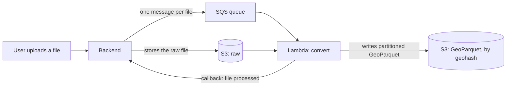
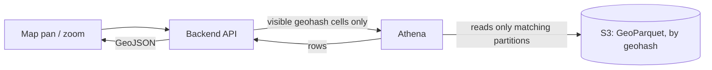

## The Problem
A web app let users upload geospatial files (CSV, GeoJSON, KML, Shapefile) and view them on a map. The first version was simple: store the file in S3, and when someone opened a layer, fetch the file and render the requested data from it.

That works for small files. It stops working as files grow, because **the cost of every request was tied to the size of the file**, not to what the user was looking at. Opening a large layer meant reading and parsing all of it. Panning or zooming paid that price again. A user looking at one neighbourhood waited as if they had asked for the whole country.

I proposed a different shape for the system: do the expensive work once, when the file is uploaded, and make every map request cheap afterwards.

## The Idea: Make Cost Follow the Viewport
Two changes make that possible:

- Convert uploads once into a **columnar format (Parquet)** that a query engine can read selectively.
- **Partition the data by location**, so a request for one part of the map only touches the pieces of data that cover it.

The result is that the time to answer a request depends on the area on screen, not on the total size of the file.

## The Architecture
**When a file is uploaded (once per file):**

**When someone pans or zooms the map (every time, cheap):**

Each piece has one job:
- **S3** holds the raw upload and the converted data.
- **SQS** decouples upload from conversion, so a slow conversion never blocks a user request.
- **Lambda** does the conversion, scaling out per file without servers to manage.
- **Athena** queries the converted data in place, so there is no database to load it into.

## Step by Step

### 1. Ingestion
The backend stores the raw file and publishes one message per logical file to the queue. For Shapefiles, which are really several files that belong together, it only sends the message after confirming in a database transaction that **every required part was uploaded**. Reacting to raw S3 events instead means guessing which sidecar files belong together, and you get a race condition when they arrive at different times.

### 2. Conversion in Lambda
For every row or feature, the Lambda:
- parses the geometry into a standard object,
- computes a **geohash** of its centroid at a fixed precision (cells a few kilometres across), which becomes its **partition key**,
- stores a bounding box and the geometry as text,
- writes everything to Parquet with a **locked-in schema**.

That last point came from a real failure: when different part files inferred different types for the same column (an integer in one, a string in another), Athena failed when it read across them. Inferring the schema once and applying it to every part file prevents it.

While streaming the rows, it also precomputes per-column statistics such as unique values and numeric ranges. Filter and legend requests can then be answered from a small file instead of re-scanning the data.

### 3. Large Files Need a Different Path
Reading a whole file into memory and uploading thousands of tiny parts one after another does not survive large inputs. A file with hundreds of thousands of features produced tens of thousands of sequential S3 writes, and the conversion ran into the Lambda timeout.

So large files take a second path:
- Stream the rows and **flush each partition's buffer to a small staging file** once it reaches a set size.
- Run a **compaction step** that merges each partition's staging files into right-sized final files.
- Delete the staging files only after every final file has been written successfully.

Small files skip all this and are converted in one pass. File size decides the path.

### 4. Layout and Metadata
Converted data lives under a path that includes the partition value, so a query engine can skip whole folders. Metadata (column lists, previews, statistics) is written under a **separate prefix**, so Athena never trips over JSON files while scanning Parquet. Large metadata is paginated: a small manifest, plus pages that are fetched only when needed.

### 5. Telling the Backend
When the Lambda finishes, it calls the backend with a shared secret to mark the file as processed. A file only shows as ready after that confirmation, never merely because the conversion started. Before downloading, the Lambda also retries its first read a few times with backoff, to absorb S3 consistency timing, and rejects sources above a size cap rather than failing halfway.

### 6. Querying with Athena
Table names are deterministic, built from identifiers the backend already knows, so the backend can find a file's table without asking Athena. Partitions are registered **explicitly, in batches**, rather than relying on partition projection, because explicit registration scales to far more partitions per table.

When the map moves, the backend:
- works out which geohash cells overlap the visible area,
- queries only those partitions, filtered by bounding box,
- pages through results (Athena returns a limited number of rows per page),
- converts the stored geometry text back into GeoJSON for the map.

Anything that ends up in a query, including partition values, has to be validated and constrained. I reviewed the query builder specifically for injection risks, and it is a place where mistakes are easy to make.

## Trade-Offs I Would Tell You About
- **Athena is not instant.** Each query has overhead of its own, and you pay for the data scanned. Partition pruning and sensible file sizes are what keep it fast and cheap.
- **Small files hurt.** Too many tiny Parquet files make queries slow. That is exactly what the compaction step exists to fix.
- **Conversion is asynchronous.** The interface needs real states: uploaded, converting, ready, failed. A map that silently shows nothing while a file converts feels broken.
- **Partition size is a tuning knob.** Too coarse and queries read too much. Too fine and you create too many partitions. Features that cross cell boundaries mean the bounding-box filter matters.
- **Keep it as simple as the problem allows.** I explored a cache layer and pre-generated vector tiles, but kept production on the straightforward path until the numbers justified the extra moving parts.

## Lessons Learned
- Pay the expensive cost once, at write time, not on every read.
- Make the unit of work follow what the user sees, not the size of the source.
- Decide the schema once and enforce it. Mixed types are an easy way to break a data lake.
- Give large inputs their own path instead of stretching the small-file path.
- Never mark something done until the system has confirmed it.
- Treat anything that reaches a query as untrusted.

## If You Are Building Something Similar
- Start by finding what actually scales with data size in your request path, and move that work earlier.
- Choose a partition key that matches how people query (here, the area on screen).
- Plan for the failure modes early: oversized files, mixed column types, many tiny parts and half-finished conversions.

If you are wrestling with slow geospatial or large-file workloads on AWS, I am happy to talk it through.
